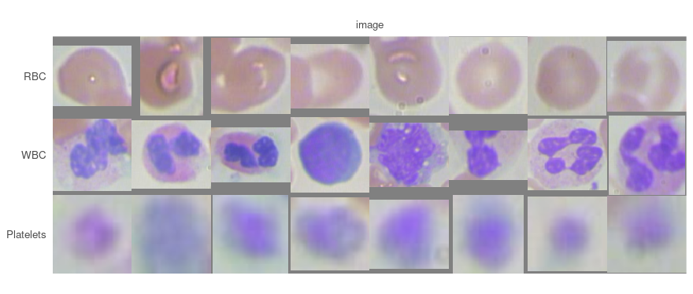
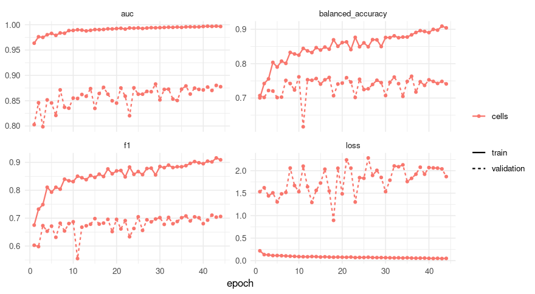
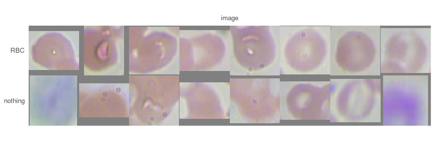
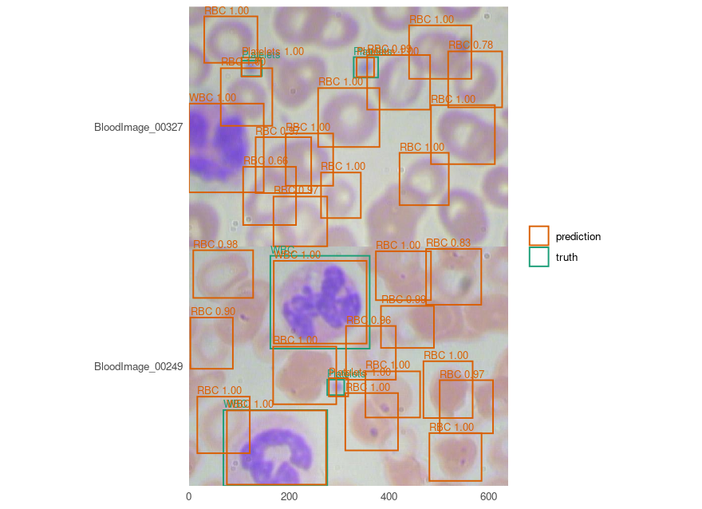

<!--
THIS PROSE HAS A COUNTERPART, AND THIS FILE IS THE SOURCE.

The engine mirrors it as pyplatypus's `classification.qmd`. It does not exist yet, so this
vignette is listed in `awaiting` in tests/testthat/test-article-pairs.R with the issue that
will write it - and that list is read in both directions, so the entry has to come out the
moment the article appears.

By maju116/rplatypus#117 the vignette is the source and the article is the copy, so an edit
here is an edit there. What is held by a test is the walk: the `##` headings and their order,
asserted from both sides. The route is deliberately not held, because the engine reaches each
destination through a configuration file where this package reaches it through constructors.
-->


A detector answers *how many objects are there and where*. A classifier answers *what is
this one picture of*. Putting them in that order - find the objects, cut them out, hand the
pieces to something that knows more classes than the detector does - is the second thing
people ask for after boxes, and it is the one join this package deliberately leaves to you.

This page is that join, on [BCCD](https://github.com/Shenggan/BCCD_Dataset), the same 364
photographs of blood smears the [detection vignette](blood-cells.html) uses. The detector is
already trained and published, so nothing here has to find the cells again.

**It does not end where it was meant to.** The classifier learns the three cell types almost
perfectly and fails completely at the one job it was added for, and the measurement that says
why is the most useful thing on the page.

Every number and every picture below was produced by running the code shown.

## Cutting the objects out, which is a decision about the data

`detection_crops()` returns arrays, and a classification run reads a directory or a CSV. The
step in between - writing the crops out - is not in the engine, and `crops()`'s own docstring
says why: *which crops are worth keeping is a decision about the data rather than about
either model.* So the decision is made here, in a few lines a reader can see and argue with.

The data wrangling is the detection page's, unchanged: BCCD arrives in Pascal VOC's layout,
one flat directory of images beside one flat directory of XML, which is neither of the two
layouts the package reads.


``` r
voc_split <- function(root, listed) {
  keys <- readLines(file.path(root, "ImageSets", "Main", paste0(listed, ".txt")))
  keys <- keys[nzchar(keys)]
  frame <- data.frame(
    key = keys,
    images = file.path(root, "JPEGImages", paste0(keys, ".jpg")),
    annotations = file.path(root, "Annotations", paste0(keys, ".xml"))
  )
  path <- file.path(tempdir(), paste0("bccd-", listed, ".csv"))
  write.csv(frame, path, row.names = FALSE)
  path
}

splits <- vapply(c("train", "val", "test"), function(s) voc_split(data_dir, s), character(1))
cells <- c("RBC", "WBC", "Platelets")
kinds <- c(cells, "nothing")
```

The annotation files are read twice below - once for what is in them and once to label a
crop - so the reader is its own function:


``` r
voc_boxes <- function(path) {
  xml <- paste(readLines(path, warn = FALSE), collapse = "")
  nodes <- regmatches(xml, gregexpr("<object>.*?</object>", xml))[[1]]
  pull <- function(tag) {
    as.numeric(sub(paste0(".*<", tag, ">([^<]*)</", tag, ">.*"), "\\1", nodes))
  }
  # Pascal VOC is 1-based and inclusive of both ends, so a box written xmin=1 xmax=10 is
  # 0..10 as a continuous interval. Reading it as 0-based shifts every box by a pixel.
  data.frame(xmin = pull("xmin") - 1, ymin = pull("ymin") - 1,
             xmax = pull("xmax"), ymax = pull("ymax"),
             name = sub(".*<name>([^<]*)</name>.*", "\\1", nodes))
}
```

The detector is borrowed rather than trained - `fit = FALSE` loads the published weights, and
the boxes come back in each photograph's own pixels:


``` r
detector <- platypus_fit(platypus_spec(
  data = detection_data(splits[["train"]], splits[["val"]], test = splits[["test"]],
                        classes = cells, mode = "config_file"),
  models = list(yolo3("cells", input_shape = c(416, 416),
                      weights = "bccd-yolo3", fit = FALSE))
), verbose = FALSE)

one <- detection_crops(detector, split = "test", size = c(96, 96))[[1]]
one$key
#> [1] "BloodImage_00007"
dim(one$crops[[1]])
#> [1] 96 96  3
head(data.frame(`colnames<-`(one$boxes, c("xmin", "ymin", "xmax", "ymax")),
                score = as.numeric(one$scores), said = one$names), 3)
#>        xmin     ymin     xmax     ymax     score said
#> 1  19.93539 300.9871 139.2865 392.0793 0.9999792  RBC
#> 2  27.77121 126.9517 140.5794 234.9014 0.9999719  RBC
#> 3 492.09385 303.5892 603.1343 396.8544 0.9999502  RBC
```


``` r
sides <- do.call(rbind, lapply(read.csv(splits[["test"]])$annotations, function(path) {
  box <- voc_boxes(path)
  data.frame(name = box$name, side = sqrt((box$xmax - box$xmin) * (box$ymax - box$ymin)))
}))
round(tapply(sides$side, sides$name, median))
#> Platelets       RBC       WBC 
#>        41       103       182
```

**`size` letterboxes rather than stretches**, so a tall box keeps its shape - and it also
throws away the one thing that separates these three classes most cleanly. Those are the
median side lengths in pixels, and they differ by a factor of
4;
brought to 96 x 96 every one of them is the same size. The classifier below has to work from
appearance alone, which is worth knowing before reading its score.

### A crop needs a label, and the label is a decision

Each crop is labelled by what it overlaps: the best unclaimed annotated object at an overlap
of at least 0.5 gives its class, and a crop that matches nothing gets a fourth class. Naming
that class rather than dropping those crops is the decision this section is about, and
`?classification_data` argues for naming: *there is no background entry - an image is one of
these, and a picture of nothing in particular is a class somebody has to name.* Dropping them
would train a classifier that believes every crop it will ever see is a cell.


``` r
overlap <- function(box, truth) {
  wide <- pmax(0, pmin(box[3], truth$xmax) - pmax(box[1], truth$xmin))
  tall <- pmax(0, pmin(box[4], truth$ymax) - pmax(box[2], truth$ymin))
  both <- wide * tall
  either <- (box[3] - box[1]) * (box[4] - box[2]) +
    (truth$xmax - truth$xmin) * (truth$ymax - truth$ymin) - both
  ifelse(either > 0, both / either, 0)
}

write_crops <- function(split, listed, into) {
  found <- detection_crops(detector, split = split, size = c(96, 96))
  files <- read.csv(splits[[listed]])
  rownames(files) <- files$key
  labels <- character(0); agreed <- logical(0); kept <- numeric(0)
  missed <- numeric(0); hit_score <- numeric(0); miss_score <- numeric(0)

  for (record in found) {
    truth <- voc_boxes(files[record$key, "annotations"])
    claimed <- rep(FALSE, nrow(truth))
    # Highest score first, so the best box gets the object and a second one on the same
    # object is what it is rather than what happened to be read first.
    for (i in order(as.numeric(record$scores), decreasing = TRUE)) {
      all_of_them <- overlap(as.numeric(record$boxes[i, ]), truth)
      free <- all_of_them
      free[claimed] <- 0
      best <- which.max(free)
      hit <- length(best) == 1L && free[best] >= 0.5

      if (hit) {
        claimed[best] <- TRUE
        kept <- c(kept, free[best])
        agreed <- c(agreed, record$names[[i]] == truth$name[best])
        hit_score <- c(hit_score, as.numeric(record$scores)[i])
        label <- truth$name[best]
      } else {
        # Kept for the section that asks what these actually are: the best overlap with
        # ANY annotated object, claimed or not. A box above 0.5 here can only be a second
        # box on an object some higher-scoring box already took.
        missed <- c(missed, if (length(all_of_them)) max(all_of_them) else 0)
        miss_score <- c(miss_score, as.numeric(record$scores)[i])
        label <- "nothing"
      }

      labels <- c(labels, label)
      target <- file.path(work, into, label)
      dir.create(target, recursive = TRUE, showWarnings = FALSE)
      png::writePNG(record$crops[[i]],
                    file.path(target, sprintf("%s-%03d.png", record$key, i)))
    }
  }
  list(counts = table(factor(labels, kinds)), agreed = agreed, overlaps = kept,
       missed = missed, hit_score = hit_score, miss_score = miss_score)
}

written <- list(
  train      = write_crops("train", "train", "train"),
  validation = write_crops("validation", "val", "valid"),
  test       = write_crops("test", "test", "test")
)
```

The dataset's own three-way split all the way through, as the detection page uses it. One
photograph's crops go to one directory, so no image has a part of itself on two sides - which
matters more here than usual, because two crops from one smear share its staining, its focus
and its patient.


``` r
tally <- do.call(rbind, lapply(names(written), function(name) {
  counts <- written[[name]]$counts
  data.frame(split = name, as.list(counts), crops = sum(counts),
             nothing_share = counts[["nothing"]] / sum(counts), check.names = FALSE)
}))
tally
#>        split  RBC WBC Platelets nothing crops nothing_share
#> 1      train 2367 214       209     129  2919    0.04419322
#> 2 validation  787  87        76     380  1330    0.28571429
#> 3       test  638  71        64     312  1085    0.28755760
```


**Read the last column before anything else.** On the images the detector trained on,
4.4% of its crops match no annotated object; on the
two splits it has never seen, 28.6% and
28.8%. A detector's output on its own training images
is not the output it will give you, and the factor here is about
6.5. Everything below is trained on the first
column and measured on the last, which is the ordinary arrangement and the reason that
difference has to be stated rather than discovered.


``` r
strip <- function(label, from = "test", n = 8) {
  files <- sort(list.files(file.path(work, from, label), full.names = TRUE))
  chosen <- files[round(seq(1, length(files), length.out = n))]
  out <- array(0, dim = c(96, 96 * n, 3))
  for (i in seq_along(chosen)) {
    out[, (i - 1) * 96 + seq_len(96), ] <- png::readPNG(chosen[i])[, , 1:3]
  }
  out
}

montage <- array(0, dim = c(length(cells), 96, 96 * 8, 3))
for (j in seq_along(cells)) montage[j, , , ] <- strip(cells[j])
plot_masks(montage * 255, labels = cells)
```



Eight crops of each cell type, evenly spaced through the test split rather than chosen. The
grey at the edge of some of them is the letterbox: a box that was not square keeps its shape
and the frame is padded. White cells are stained purple and unmistakable; platelets are blurred
because a 40-pixel object brought to 96 is an object magnified two and a half times.

## What the detector already answers

Before training anything it is worth asking what a second model could add, and the answer is
measurable in one line. Of the crops that **do** match an annotated object, how often was the
detector's own class right?


``` r
data.frame(
  split = names(written),
  matched = vapply(written, function(w) length(w$agreed), integer(1)),
  agreed = vapply(written, function(w) sum(w$agreed), integer(1)),
  overlap = round(vapply(written, function(w) mean(w$overlaps), numeric(1)), 4),
  row.names = NULL
)
#>        split matched agreed overlap
#> 1      train    2790   2790  0.9099
#> 2 validation     950    950  0.8118
#> 3       test     773    772  0.8160
```


**1 wrong out of 1,723 on the two splits the detector
never trained on.** A detector's class head sees the object at the scale it occurs, with the
whole photograph around it; a classifier sees a 96 x 96 crop with the scale normalised away.
On this dataset the first is already right essentially always, so naming the three cell types
again is not work worth doing.

What is left is the other column: between a quarter and a third of what the detector hands
over matches no annotated object at all. **So the question this page can usefully ask is not
*what is this crop* but *is this crop anything*** - and that is the question the fourth class
exists to answer.

## The classifier, and the metric that is not accuracy


``` r
recipe <- function(seed = 1, loss = NULL) {
  platypus_spec(
    data = classification_data(
      train = file.path(work, "train"),
      validation = file.path(work, "valid"),
      test = file.path(work, "test"),
      classes = kinds,
      mode = "nested_dirs"
    ),
    models = list(classifier(
      "cells",
      input_shape = c(96, 96),
      # No `encoder`, so this is the package's own contracting path. `block_width` rather
      # than another level: halving a 96-pixel crop four times leaves a platelet with
      # nothing, and `?classifier` names a crop of one cell as the case this lever is for.
      blocks = 3, filters = 16, block_width = 2,
      epochs = 60, batch_size = 32,
      optimizer = optimizer_adam(learning_rate = 1e-3),
      # A smear has no up and no down, so all three of these are free.
      augmentation = list(
        augmentation_step("HorizontalFlip", p = 0.5),
        augmentation_step("VerticalFlip", p = 0.5),
        augmentation_step("RandomRotate90", p = 0.5)
      ),
      loss = loss,
      metrics = list(metric_auc(), metric_balanced_accuracy(), metric_f1()),
      callbacks = list(
        callback_cosine_annealing(),
        callback_early_stopping(monitor = "val_auc", patience = 15, restore_best = TRUE)
      )
    )),
    seed = seed
  )
}

spec <- recipe()
```

`class_balance()` is worth running before the fit rather than after it, because the prevalence
is what every later decision turns on:


``` r
class_balance(spec)
#>      class    n      share
#>        RBC 2367 0.81089414
#>        WBC  214 0.07331278
#>  Platelets  209 0.07159986
#>    nothing  129 0.04419322
#> 
#> 2919 images in 4 classes
#>   RBC                         2367  81.09%
#>   WBC                          214   7.33%
#>   Platelets                    209   7.16%
#>   nothing                      129   4.42%
#>   rarest: nothing at 4.42%
#>   below about 10% a metric read off the hard prediction stops telling a model from a collapse, so `auc` is the one to watch
```

The sentence under that table is the engine's own, printed rather than copied, and it is the
reason `metric_accuracy()` is offered here and is not the default: four fifths of the
training crops are red cells, so a model that answers `RBC` to everything scores four fifths
on this split and has learned nothing at all. The scoring section below puts that pair of
numbers side by side on the split it is measured on.


``` r
fit <- platypus_fit(spec, verbose = FALSE)
fit
#> platypus fit
#>   models   : cells 
#>   device   : NVIDIA GeForce GTX 1070 (torch 2.7.1+cu126) 
#>   epochs   : cells=44 
#>   stopped  : cells - early stopping: val_auc has not improved on 0.88287 for 15 epochs 
#>   next     : evaluate(fit), predict(fit, "cells")
```


``` r
plot(fit)
```



**The gap between the two lines is the whole of what 2,919
crops buys.** Training AUC reaches 0.9972 while validation
stops at 0.8829, and the loss panel is the clearer half: the
training loss falls to 0.047 while the validation
loss **rises** from 1.53 to
1.87. The model is memorising crops.
Early stopping restored epoch 29 of
44 - the best `val_auc`, which is what it was told to watch - and
nothing after it was learning anything that transfers.

**The `best_epoch` column in the table below says the same number, and this page is why it
does.** It used to be the lowest validation *loss*, read off the history whatever the
callback was watching - so on a run like this one, whose loss rises from the first epoch
while its AUC keeps improving, the row named one epoch and scored another. Writing this page
printed the two side by side, which is how anybody noticed; `maju116/pyplatypus#398` fixed it
in `0.8.0a68`, and the column is now the epoch the row's own scores came from. It is empty
rather than wrong when they came from no single epoch - an average, or a run that selected
nothing and therefore ended on its last, which `epochs_run` already names.

## Scoring per class, because the mean is the commonest class


``` r
score <- evaluate(fit, split = "test")
score
#>   model architecture loss_function parameters split epochs_run best_epoch
#> 1 cells    plain_cnn           cce     294516  test         44         29
#>       loss      auc balanced_accuracy        f1
#> 1 1.885172 0.878069         0.7209535 0.6783647
```


``` r
said <- predict(fit, split = "test")
head(said, 3)
#>                                  key     label predicted probability
#> 1 Platelets/BloodImage_00011-008.png Platelets Platelets   0.9325355
#> 2 Platelets/BloodImage_00015-007.png Platelets Platelets   0.9153976
#> 3 Platelets/BloodImage_00016-010.png Platelets Platelets   0.6201115
table(truth = factor(said$label, kinds), said = factor(said$predicted, kinds))
#>            said
#> truth       RBC WBC Platelets nothing
#>   RBC       638   0         0       0
#>   WBC         0  71         0       0
#>   Platelets   0   1        50      13
#>   nothing   254   5        21      32
```


``` r
c(accuracy = mean(said$label == said$predicted),
  always_the_commonest = max(table(said$label)) / nrow(said))
#>             accuracy always_the_commonest 
#>            0.7290323            0.5880184
```

**An accuracy of 0.729 against
0.588 for a model that answers `RBC` to
everything.** That is the whole argument for the default metric in one pair of numbers: the
gap is 0.141,
and a reader told only the first would believe something had been learned about all four
classes. Balanced accuracy, which weighs a rare class as much as a common one, reads
0.721.

The table above says where it went. The three cell types are nearly perfect - red cells
638 of
638, white cells 71
of 71, platelets
50 of
64. The fourth class is a rout:
32 of
312, with
254 of them called a red cell.

### Two things that do not help, measured rather than assumed

A second seed of the same recipe, and the loss that exists for exactly this problem - focal
cross-entropy, which loses interest in what it already gets right:


``` r
rejected <- function(answers) {
  sum(answers$label == "nothing" & answers$predicted == "nothing") /
    sum(answers$label == "nothing")
}

arms <- list(`seed 2` = recipe(seed = 2), focal = recipe(loss = loss_focal(gamma = 2)))
others <- lapply(arms, function(s) {
  run <- platypus_fit(s, verbose = FALSE)
  cbind(evaluate(run, split = "test"), rejected = rejected(predict(run, split = "test")))
})
cbind(arm = c("seed 1", names(others)),
      do.call(rbind, c(list(cbind(score, rejected = rejected(said))), others))[
        , c("auc", "balanced_accuracy", "rejected")])
#>           arm       auc balanced_accuracy  rejected
#> 1      seed 1 0.8780690         0.7209535 0.1025641
#> seed 2 seed 2 0.8668425         0.7152289 0.1250000
#> focal   focal 0.8783265         0.7463787 0.1089744
```


Two seeds of one recipe differ by 0.0112 of AUC and focal loss moves
it by 0.0003, which are the same order of magnitude - and **two runs
are not a spread**, so neither figure is worth a conclusion on its own. The column that can
carry one is the last: the share of the detector's unmatched boxes that the model rejects
runs from 0.10 to 0.12 across all
three, which is to say that none of them does it. The arms differ in the figure that is
noisy and agree in the one the page is about.

## The class that is not a picture of anything

The obvious repair is not to make the classifier choose, but to ask it for a probability and
reject a crop when it is confident enough. The threshold is a decision about cost, so it is
chosen on the validation split and only then read on the test split:


``` r
reject_at <- function(split, thresholds = c(0.1, 0.3, 0.5, 0.7, 0.9, 0.99)) {
  answers <- predict(fit, split = split)
  chance <- predict(fit, split = split, type = "probability")[answers$key, "nothing"]
  cell <- answers$label != "nothing"
  do.call(rbind, lapply(thresholds, function(t) {
    dropped <- chance > t
    data.frame(split = split, threshold = t,
               cells_kept = sum(!dropped & cell) / sum(cell),
               alarms_dropped = sum(dropped & !cell) / sum(!cell),
               precision = sum(!dropped & cell) / sum(!dropped))
  }))
}

ladder <- rbind(reject_at("validation"), reject_at("test"))
ladder
#>         split threshold cells_kept alarms_dropped precision
#> 1  validation      0.10  0.9557895     0.15789474 0.7394137
#> 2  validation      0.30  0.9831579     0.12105263 0.7365931
#> 3  validation      0.50  0.9905263     0.09736842 0.7328660
#> 4  validation      0.70  0.9957895     0.06052632 0.7260169
#> 5  validation      0.90  1.0000000     0.01842105 0.7180650
#> 6  validation      0.99  1.0000000     0.00000000 0.7142857
#> 7        test      0.10  0.9508409     0.17628205 0.7409274
#> 8        test      0.30  0.9715395     0.12820513 0.7341153
#> 9        test      0.50  0.9831824     0.10256410 0.7307692
#> 10       test      0.70  0.9896507     0.07051282 0.7251185
#> 11       test      0.90  1.0000000     0.02243590 0.7170686
#> 12       test      0.99  1.0000000     0.00000000 0.7124424
```


Precision before any of this is 0.7124 - the share of what the detector
hands over that is an annotated object. The best this buys on the test split is
0.7409, at the cost of
4.9% of the real cells: **a gain of
0.028 of precision for
38
cells, from a second model, a second dataset and a second training run.**

And a second model has to be worth more than the one number the first one already has. The
detector's `operating_point` buys the same trade with nothing trained:


``` r
mine <- predict(detector, split = "test")
files <- read.csv(splits[["test"]])
rownames(files) <- files$key

detector_at <- function(cut) {
  boxes <- 0; hits <- 0
  for (key in names(mine)) {
    truth <- voc_boxes(files[key, "annotations"])
    claimed <- rep(FALSE, nrow(truth))
    above <- mine[[key]][mine[[key]]$score >= cut, ]
    above <- above[order(above$score, decreasing = TRUE), ]
    for (i in seq_len(nrow(above))) {
      ratios <- overlap(c(above$xmin[i], above$ymin[i], above$xmax[i], above$ymax[i]), truth)
      ratios[claimed] <- 0
      best <- which.max(ratios)
      if (length(best) == 1L && ratios[best] >= 0.5) {
        claimed[best] <- TRUE
        hits <- hits + 1
      }
    }
    boxes <- boxes + nrow(above)
  }
  data.frame(operating_point = cut, boxes = boxes, cells_kept = hits / sum(said$label != "nothing"),
             precision = hits / boxes)
}

curve <- do.call(rbind, lapply(c(0.5, 0.7, 0.8, 0.9, 0.95, 0.99), detector_at))
curve
#>   operating_point boxes cells_kept precision
#> 1            0.50  1085  1.0000000 0.7124424
#> 2            0.70  1028  0.9715395 0.7305447
#> 3            0.80   990  0.9547219 0.7454545
#> 4            0.90   942  0.9275550 0.7611465
#> 5            0.95   907  0.8990944 0.7662624
#> 6            0.99   773  0.8111255 0.8111255
```


The first row is the one everything above was measured at, and `boxes` reproduces the
1,085 crops as a control that this is the same set of
predictions read a second way. The rest of the table is the same trade the classifier was
making, made by one argument: at an `operating_point` of 0.8, the
detector keeps 0.955 of the cells against the classifier's
0.951, at a precision of
0.7455 against 0.7409.
**A number that is already in the specification is on the same curve as a second model**, and
that is the comparison a page like this owes before it recommends anything.

So the rejector does not work, and the interesting question is why not. It is not the
threshold and not the loss. It is the label.


``` r
un <- written$test
table(cut(un$missed, c(-Inf, 0, 0.25, 0.5, Inf),
          labels = c("overlaps nothing annotated", "barely touches one (< 0.25)",
                     "off its object (0.25 to 0.5)", "a second box on a claimed object")))
#> 
#>       overlaps nothing annotated      barely touches one (< 0.25) 
#>                               92                              182 
#>     off its object (0.25 to 0.5) a second box on a claimed object 
#>                               31                                7
round(c(unmatched = median(un$miss_score), matched = median(un$hit_score)), 4)
#> unmatched   matched 
#>    0.9864    0.9999
```

**The detector is not guessing.** Those boxes carry a median score of
0.986 against
0.9999 for the ones that do match, and
92 of 312 of them overlap no annotated object
whatsoever. A box that overlaps nothing, at a confidence of 0.99, on a picture of a blood
smear, is either a mistake with no cause or a cell nobody wrote down. Looking at them settles
which:


``` r
pair <- c("RBC", "nothing")
both <- array(0, dim = c(2, 96, 96 * 8, 3))
for (j in seq_along(pair)) both[j, , , ] <- strip(pair[j])
plot_masks(both * 255, labels = pair)
```



The bottom row is the fourth class, and it is the top row again: red cells, whole and
overlapping, one out-of-focus smudge of exactly the kind the platelet row is made of, and at
the end a patch of the purple a white cell is stained with. **`nothing` is not
a picture of anything - it is a statement about the annotation**, and the question *is this
cell written down in the XML* is not answerable from a picture of the cell. The classifier is
not failing; it is refusing a question that has no answer in its input.

One photograph makes the point better than the table does:


``` r
extra <- vapply(names(mine), function(k) {
  nrow(subset(mine[[k]], score >= 0.5)) - nrow(voc_boxes(files[k, "annotations"]))
}, numeric(1))
pick <- names(sort(extra, decreasing = TRUE))[1:2]

data.frame(key = pick,
           annotated = vapply(pick, function(k) nrow(voc_boxes(files[k, "annotations"])),
                              numeric(1)),
           found = vapply(pick, function(k) nrow(subset(mine[[k]], score >= 0.5)),
                          numeric(1)),
           row.names = NULL)
#>                key annotated found
#> 1 BloodImage_00327         2    16
#> 2 BloodImage_00249         3    16

plot_boxes(read_images(files[pick, "images"], size = NULL), mine[pick],
           truth = lapply(pick, function(k) voc_boxes(files[k, "annotations"])),
           min_score = 0.5)
```



Green is the annotation and orange is the detector. The extra boxes are not errors; they are
red cells. BCCD annotates a subset of what is in some of its photographs, and a model trained
on 205 images of it learned to find cells rather than to find annotations - which is the right
thing to have learned and the reason a quarter of its output scores as wrong.

**What this costs beyond this page**: a precision measured against an incomplete annotation is
a lower bound rather than an estimate, so the per-class precision in the
[detection vignette](blood-cells.html) understates the detector by an unknown amount. The
figure is correct about the data and should not be read as a count of mistakes.

## What this does not do

**It does not show a classifier earning its place.** On this dataset the detector already
names its objects correctly 99.94%
of the time, so the second model has nothing to add. Where one does earn its place is where
the classes are **finer than the detector's**: a detector that finds cells and a classifier
that names twenty kinds of them, trained on crops whose labels come from somewhere other than
the boxes. The surface on this page is the same one; only the labels would differ.

**It is not a measurement of the annotation.** That a detector finds cells no annotation
mentions says the annotation is incomplete on those images; how incomplete, on which images
and for which class is a question somebody would have to answer by looking, and nothing here
did.

**The crops lose the scale.** Every one is 96 x 96 whatever it was cut from, so the single
most separable property of these three classes is gone before the classifier sees anything.
`size = NULL` keeps each crop as cut, and then they cannot be stacked into one batch without
a decision of your own.

**It is one small collection.** 205 training photographs at one magnification, stained one
way, and the three classes it holds are easy to tell apart by eye. **It is not a diagnostic
tool**, and a result from it is not a laboratory result.

## Notes on the machine

Trained on a GTX 1070, three runs of about two minutes each; the detector is loaded rather
than trained, and cutting and writing 5,334
crops takes about a minute, which makes this the cheapest of the seven vignettes that run
something.

A card of that generation needs the CUDA 12 build of PyTorch, which
`platypus_use_torch("pascal")` selects - see `?platypus_device`.
