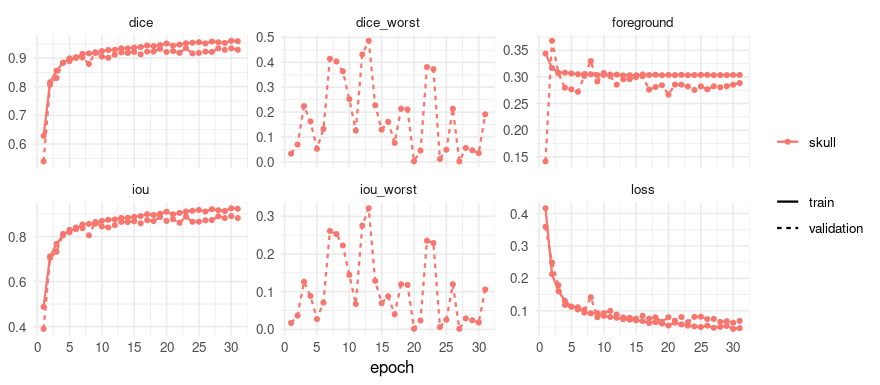
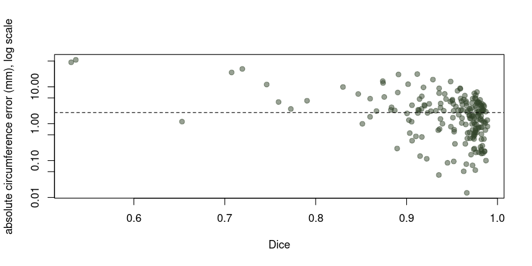

<!--
THIS PROSE HAS A COUNTERPART, AND THIS FILE IS THE SOURCE.

The engine mirrors it as pyplatypus's `fetal-head.qmd`. By maju116/rplatypus#117 the
vignette is the source and the article is the copy, so an edit here is an edit there, and an
edit there alone is a mistake nothing will catch. What is held by a test is the walk: the
`##` headings and their order, asserted from both sides - `tests/testthat/test-article-pairs.R`
here and `tests/test_articles.py` in the engine. The route is deliberately not held, because
the engine reaches each destination through a configuration file where this package reaches
it through constructors.

Every number in the prose below is an inline `r` expression rather than a typed figure. That
is not a style choice: this page is almost entirely numbers, and a number typed into prose is
one nothing holds to the run that produced it. CLAUDE.md §3C is the rule; `maju116/pyplatypus#205`
is where the measurement came from.
-->


Every other vignette here ends on a score. This one ends on a **length in millimetres**,
because that is what a sonographer writes down: a fetal head circumference, measured from an
ultrasound image, read against a gestational chart. Nobody charts a Dice.

That difference is the whole of the page, and it turns out to be sharper than it sounds. The
two columns - overlap and millimetres - rank the same images **differently**, and a model
chosen on the first is not the model you wanted.

[HC18](https://zenodo.org/records/1327317) is 999 two-dimensional ultrasound images of the
fetal skull with an ellipse drawn round each one by a sonographer, and a CSV giving every
image's pixel size in millimetres and the circumference that was recorded. It is CC BY 4.0.
Point `PLATYPUS_HC18` at the unpacked directory.

## Why a circumference is not a score

A Dice asks how many pixels two masks share. A circumference asks how long the boundary of
one of them is. Those are not the same question and they fail in different directions:

**A ragged boundary barely moves an integral over a region.** Add and remove pixels along the
edge in roughly equal measure and the area, and the ellipse fitted to it, hardly move - while
the Dice falls with every one of them.

**A mask that is systematically too fat or too thin moves it linearly.** Grow the whole
outline by a pixel and the circumference grows with it, every time, in one direction - while
the Dice barely notices, because a one-pixel rim is a small share of a large blob.

So the two errors Dice is *most* and *least* able to see are the wrong way round for anybody
measuring a length. That is an argument until it is measured; the last two sections measure
it.

## The data


``` r
root <- file.path(Sys.getenv("PLATYPUS_HC18"), "training_set", "training_set")
stopifnot(dir.exists(root))

reference <- read.csv(
  file.path(Sys.getenv("PLATYPUS_HC18"), "training_set_pixel_size_and_HC.csv"),
  check.names = FALSE
)
names(reference) <- c("filename", "pixel_mm", "hc_mm")
str(reference, give.attr = FALSE)
#> 'data.frame':	999 obs. of  3 variables:
#>  $ filename: chr  "000_HC.png" "001_HC.png" "002_HC.png" "003_HC.png" ...
#>  $ pixel_mm: num  0.0691 0.0897 0.062 0.0913 0.0612 ...
#>  $ hc_mm   : num  44.3 56.8 68.8 69 59.8 ...
```

Each image has an `_Annotation.png` beside it, and that file is **a drawn curve rather than a
filled region** - an ellipse one or two pixels wide, with nothing inside it. A segmentation
model needs the region, so the curve has to be filled before anything can be trained.


``` r
# The annotation is a CLOSED CURVE with nothing inside it, so the region has to be filled
# before anything can be trained. That is a hole fill rather than a scanline: flood the
# background inward from the frame, and what the flood cannot reach is the inside.
#
# Written as waves over indices rather than by dilating the whole image, because each pixel
# then enters the frontier once - the work is the size of the background instead of the
# background times the image's diameter. About 0.07 s an image here.
fill_holes <- function(drawn) {
  nr <- nrow(drawn)
  nc <- ncol(drawn)
  open <- !drawn
  seen <- matrix(FALSE, nr, nc)
  border <- unique(c(1:nr, nr * (nc - 1) + 1:nr,
                     seq(1, nr * nc, by = nr), seq(nr, nr * nc, by = nr)))
  frontier <- border[open[border]]
  seen[frontier] <- TRUE
  while (length(frontier)) {
    row <- ((frontier - 1L) %% nr) + 1L
    nxt <- c(frontier[row > 1L] - 1L, frontier[row < nr] + 1L,
             frontier[frontier > nr] - nr, frontier[frontier <= nr * (nc - 1L)] + nr)
    nxt <- unique(nxt[open[nxt] & !seen[nxt]])
    seen[nxt] <- TRUE
    frontier <- nxt
  }
  !seen
}

masks <- file.path(tempdir(), "hc18-masks")
dir.create(masks, showWarnings = FALSE)

prepared <- lapply(reference$filename, function(name) {
  annotation <- png::readPNG(file.path(root, sub("\\.png$", "_Annotation.png", name)))
  if (length(dim(annotation)) == 3) annotation <- annotation[, , 1]
  drawn <- annotation > 0.5
  filled <- fill_holes(drawn)
  # A curve that runs off the edge of the frame does not enclose anything: its inside is
  # connected to the outside, the flood reaches all of it, and the fill returns the curve
  # unchanged. So "did this fill" is "is the result at least twice the line I drew", which
  # needs no reference and no threshold anybody chose.
  path <- file.path(masks, name)
  if (sum(filled) >= 2 * sum(drawn)) {
    png::writePNG(matrix(as.numeric(filled), nrow(filled)), path)
  }
  data.frame(filename = name, mask = path, closed = sum(filled) >= 2 * sum(drawn))
})
prepared <- do.call(rbind, prepared)

open_curves <- prepared$filename[!prepared$closed]
open_curves
#> [1] "186_HC.png"  "346_HC.png"  "628_2HC.png" "787_HC.png"
```

4 of 999 annotations are open and are dropped. The
sonographer's ellipse continues outside the picture, so the recorded millimetres describe a
shape the file does not contain - a real limitation of this instrument rather than a defect
in the data, and the reason fitting a conic to the visible arc is how the literature handles
it. Kept, they would contribute images whose mask is a line, which is the kind of thing a
mean never shows you.

## Splitting by examination, not by image


``` r
cases <- data.frame(
  # The key is what `evaluate_cases()` reports and what `group_by` reads.
  key = tools::file_path_sans_ext(prepared$filename[prepared$closed]),
  images = file.path(root, prepared$filename[prepared$closed]),
  masks = prepared$mask[prepared$closed]
)
csv <- file.path(tempdir(), "hc18.csv")
write.csv(cases, csv, row.names = FALSE)

# `000_HC`, `628_2HC`: the leading number is the EXAMINATION, and several images can come
# from one. Dividing by file puts near-duplicates of the same skull on both sides.
examinations <- length(unique(sub("_.*$", "", cases$key)))
c(images = nrow(cases), examinations = examinations)
#>       images examinations 
#>          995          803
```

995 images from 803 examinations. Dividing at random by file would
put an image of an examination in training and another image of **the same examination** in
the test set, and the score would be partly a memory test. `group_by` is where that belongs.

## The specification


``` r
spec <- platypus_spec(
  task = "semantic_segmentation",
  data = segmentation_data(
    train = csv,
    mode = "config_file",
    colormap = list(c(0, 0, 0), c(255, 255, 255)),
    split = list(
      # Three fractions, not two. The millimetres are reported on the third, so no number
      # on this page comes off the data `early_stopping` watched.
      fractions = c(0.6, 0.2, 0.2),
      group_by = "^(\\d+)_",
      seed = 1
    )
  ),
  models = list(
    u_net(
      name = "skull",
      # 800 x 540 arrives as 800 x 544, which divides by 2^4 and resamples the data almost
      # not at all. A measurement that ends in millimetres should argue with the ellipse,
      # not with the interpolation.
      input_shape = c(544, 800),
      blocks = 4,
      filters = 16,
      batch_size = 4,
      epochs = 40,
      loss = loss_cce_dice(),
      metrics = list(metric_dice(include_background = FALSE),
                     metric_iou(include_background = FALSE)),
      optimizer = optimizer_adam(learning_rate = 1e-3),
      callbacks = list(
        callback_early_stopping(monitor = "val_dice", patience = 8, restore_best = TRUE)
      ),
      augmentation = list(
        # No vertical flip: an ultrasound fan has a top and a bottom, and a mirrored one is
        # a picture of nothing. The ellipse is symmetric under the horizontal one.
        augmentation_step("HorizontalFlip", p = 0.5),
        augmentation_step("RandomBrightnessContrast", p = 0.3)
      )
    )
  )
)
```

## Training


``` r
# Timed here rather than read off the fit, which does not carry a clock: the note at the
# end quotes this, and a number quoted from an object that has no such field renders as
# nothing at all without failing.
elapsed <- system.time(fit <- platypus_fit(spec, num_workers = 4))
fit
#> platypus fit
#>   models   : skull 
#>   device   : NVIDIA GeForce GTX 1070 (torch 2.7.1+cu126) 
#>   epochs   : skull=31 
#>   stopped  : skull - early stopping: val_dice has not improved on 0.93503 for 8 epochs 
#>   next     : evaluate(fit), predict(fit, "skull")
```


``` r
plot(fit)
```



## From a mask to a millimetre

A prediction is a mask on a grid. A circumference is a length in the world, and the thing
that connects the two is the **pixel size**, which is a property of the file rather than of
the model.


``` r
# `space = "source"` rather than the model's grid. The pixel size in the CSV describes the
# image as it is on disk; a prediction resized to the model's input shape has pixels of a
# size nobody recorded, and multiplying by the file's number would be wrong by the ratio of
# the two shapes.
#
# The list comes back NAMED BY CASE, which is what makes the join below a join rather than
# a pairing by position - and the name and the mask come out of one step of the engine's
# own stream, so they cannot be misaligned. That was not true until
# `maju116/rplatypus#223`: writing this page is what found it.
predicted <- predict(fit, "skull", split = "test", space = "source")

sizes <- setNames(reference$pixel_mm, tools::file_path_sans_ext(reference$filename))
recorded <- setNames(reference$hc_mm, tools::file_path_sans_ext(reference$filename))

measured <- do.call(rbind, lapply(names(predicted), function(key) {
  px <- sizes[[key]]
  # `ellipse_measure()` fits an ellipse to the largest filled object and returns its axes
  # and Ramanujan's circumference. `spacing` scales the COORDINATES rather than the answer:
  # a perimeter is not separable in its axes, so there is no number to multiply a
  # pixel-space circumference by unless the pixels are square.
  data.frame(key = key, ellipse_measure(predicted[[key]], spacing = c(px, px)))
}))
head(measured, 3)
#>      key    major    minor circumference
#> 1 080_HC 13.61917 11.01925      77.24687
#> 2 153_HC 16.80449 14.34755      97.92852
#> 3 284_HC 31.03666 24.53383     167.86182
```


``` r
cases_scored <- evaluate_cases(fit, "skull", split = "test")
dice <- setNames(cases_scored$dice, cases_scored$case)

against <- data.frame(
  key = measured$key,
  dice = unname(dice[measured$key]),
  mm = measured$circumference,
  recorded = unname(recorded[measured$key])
)
against$error_mm <- against$mm - against$recorded
summary(abs(against$error_mm))
#>     Min.  1st Qu.   Median     Mean  3rd Qu.     Max. 
#>  0.01329  0.67454  1.96079  3.50467  3.61206 53.88898
```

## What the annotation costs before the model does

Before blaming the model for a millimetre, measure what the pipeline costs with **no model at
all**: put the truth masks through the same ellipse fit and compare those circumferences with
the sonographer's.


``` r
truth <- do.call(rbind, lapply(against$key, function(key) {
  mask <- png::readPNG(file.path(masks, paste0(key, ".png"))) > 0.5
  px <- sizes[[key]]
  # The engine reads a mask whose classes are values, so the filled region is class 2.
  fitted <- ellipse_measure(mask + 1L, spacing = c(px, px))$circumference
  # And the line the sonographer drew, in pixels: its area over the perimeter it encloses.
  # This is the quantity the paragraph below CLAIMS is the cause, so it is measured here
  # rather than asserted - a width of w puts the filled boundary w/2 outside the curve, and
  # a radius larger by w/2 makes a circumference larger by pi * w.
  outline <- png::readPNG(file.path(root, paste0(key, "_Annotation.png"))) > 0.5
  # In pixels on both sides of the division, so the answer is a pixel count: the perimeter
  # is measured again without `spacing` rather than divided back out of the millimetre one.
  width_px <- sum(outline) / ellipse_measure(mask + 1L)$circumference
  data.frame(key = key, mm = fitted, width_px = width_px,
             predicted_mm = pi * width_px * px)
}))

errors <- truth$mm - against$recorded
floor_bias <- mean(errors)
floor_mae <- mean(abs(errors))
c(bias_mm = floor_bias, mae_mm = floor_mae,
  line_width_px = mean(truth$width_px),
  predicted_mm = mean(truth$predicted_mm),
  correlation = cor(truth$predicted_mm, errors),
  residual_mae_mm = mean(abs(errors - truth$predicted_mm)))
#>         bias_mm          mae_mm   line_width_px    predicted_mm     correlation 
#>      1.12060105      1.12060105      2.52322765      1.10771555      0.99967824 
#> residual_mae_mm 
#>      0.01371169
```

The truth masks are out by +1.12 mm on average, and that number is
**not** an error of this package. HC18's annotation is a drawn curve of finite width - these
are 2.52 pixels wide - and the mask is that curve filled,
so the region's boundary sits half a width outside the ellipse the sonographer drew. A radius
larger by `w/2` makes a circumference larger by `pi * w`, which predicts
+1.11 mm against the
+1.12 mm measured, correlated at
1.000 across the split with
0.01 mm left over.

That is the difference between an explanation and a guess, and it is why the prediction is
reported **beside** the bias rather than subtracted from it: a correction folded into the
measurement would hide the one number on this page that is about the dataset rather than
about us. A model reproducing the truth masks perfectly would still read
+1.12 mm high **on this split**, and that figure is not a constant
of the dataset: it is `pi * w` converted to millimetres, so it scales with the pixel size,
which HC18 records per image. The engine's article measures the same thing on its own split
and gets a smaller number for that reason, not a different answer.

So the model's own contribution is the comparison against the truth masks rather than against
the chart, and both belong on a page that reports millimetres. Reporting only the first blames
the model for a drawing convention; reporting only the second hides the convention from the
person reading the number.

## The Dice cannot see this error


``` r
publishable <- against[against$dice >= 0.95, ]
over <- sum(abs(publishable$error_mm) > 2)

# Both orderings run best-first - by Dice descending and by error ASCENDING - so a shared
# ordering is +1 and no ordering at all is 0. That is the direction
# `examples/measure_fetal_head_circumference.py` reports, and a pair whose two halves
# disagree about the sign of one statistic is worse than a pair that does not carry it.
spearman <- cor(against$dice, -abs(against$error_mm), method = "spearman")

c(
  dice_mean = mean(against$dice),
  median_error_mm = median(abs(against$error_mm)),
  mean_error_mm = mean(abs(against$error_mm)),
  spearman = spearman
)
#>       dice_mean median_error_mm   mean_error_mm        spearman 
#>       0.9424884       1.9607895       3.5046740       0.3454987
```

Of the 133 test images scoring 0.95 or better - a figure anybody would
publish - **55 are still wrong by more than 2 mm**
(41%). The Spearman correlation between the
two orderings is 0.35, where a shared ordering would be 1 and no
relationship at all would be 0.


``` r
plot(
  against$dice, abs(against$error_mm), log = "y",
  xlab = "Dice", ylab = "absolute circumference error (mm), log scale",
  pch = 19, col = grDevices::adjustcolor("#33442b", alpha.f = 0.5)
)
abline(h = 2, lty = 2)
```



Read the vertical spread at any fixed Dice. A column of points two orders of magnitude tall
is the finding: the score does not tell you what the measurement will be.


``` r
worst <- against[order(-abs(against$error_mm)), ][1:5, ]
worst[, c("key", "dice", "mm", "recorded", "error_mm")]
#>         key      dice        mm recorded  error_mm
#> 185  009_HC 0.5361094 116.19898    62.31  53.88898
#> 64  023_2HC 0.5310252 114.16147    67.90  46.26147
#> 148  753_HC 0.7192976 262.64523   293.20 -30.55477
#> 105 133_4HC 0.7075314  72.45699    97.00 -24.54301
#> 76   802_HC 0.9117828 308.75427   330.90 -22.14573
```

The median absolute error is 1.96 mm and the
mean is 3.50 mm. **Both belong here because they
disagree**: the distribution has a long tail, so the mean describes the tail rather than a
typical case, and the median alone would hide that some images are out by the width of a
head.

## What this does not settle

**One run.** The same recipe, trained again, gives a different correlation. Three runs of it
on the engine's side measured 0.62, 0.44 and 0.15, and this page is a fourth at
0.35:


```
#>                     run spearman
#> 1    the engine example    0.620
#> 2              a second    0.435
#> 3 the published weights    0.153
#> 4         this vignette    0.345
```

All four are far from a shared ordering and they span a factor of four. The *direction* is
the finding here; the magnitude is one draw, and a single number quoted from this page would
overstate the case at one end.

The published `hc18-unet` weights are one of those runs rather than this one:


``` r
listing <- available_weights()
listing$description[listing$name == "hc18-unet"]
#> [1] "U-Net, 544x800, the fetal skull in 2D ultrasound, for measuring **head circumference in millimetres**. HC18 (CC BY 4.0), split by examination rather than by row. Median absolute error 2.44 mm against the sonographer's measurement over 199 held-out images, mean 3.84 mm, worst 48.07 mm - and 3.41 mm against the truth mask's own circumference, which is this model's contribution rather than the dataset's drawing convention. **Do not choose these weights on the Dice**: it is 0.9494, it orders the cases differently from the millimetres, and 85 of the 144 cases scoring 0.95 or better are still wrong by more than 2 mm. **CC BY 4.0, not MIT**, because the data is."
```

**A measurement is not a measuring instrument.** The worst case on this page is out by
54 mm, which is not a biometric tool with a
person looking at it, let alone without.

**The ellipse is the shape assumed.** `ellipse_measure()` fits one, which is right for a
fetal skull and wrong for anything that is not an ellipse. The general case - every object in
an image, measured separately - is `maju116/pyplatypus#272` and is not built.

## Notes on the machine

Precomputed on a GTX 1070, which needs the CUDA 12 line of PyTorch; `platypus_use_torch("pascal")`
at the top of this document is what selects it. Training is
22 minutes at these settings, over
31 epochs. Nothing on this page depends on which card it was, except how long it took.
