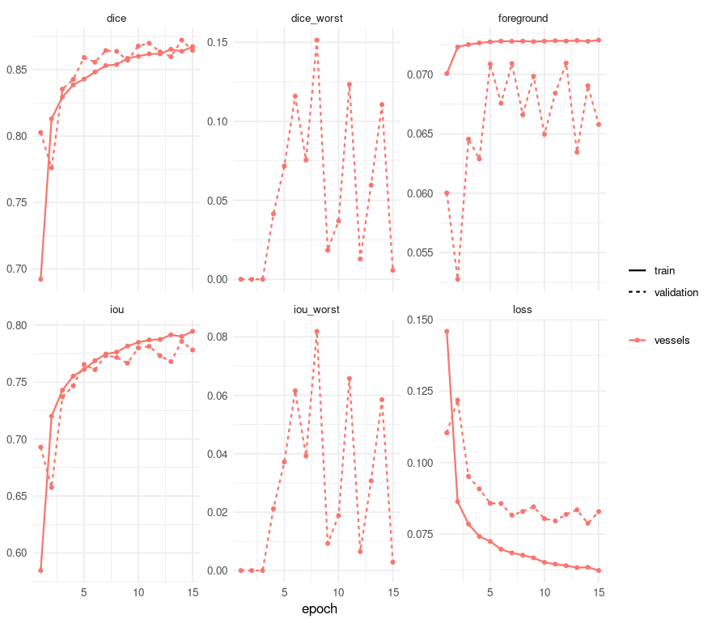
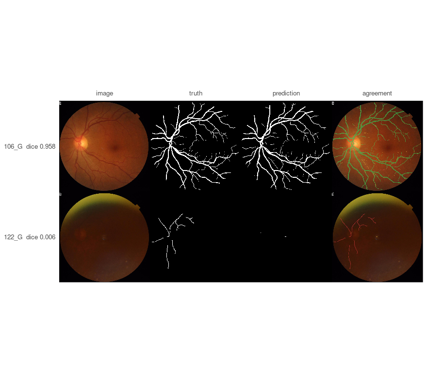

The other vignettes work on images small enough to hand a network whole. This one does not,
and that is the point: a retinal fundus photograph is 2048 x 2048, the thing to find in it is
about nine pixels wide, and resizing to fit the model destroys the measurement before the
model ever sees it.

Three things here appear in no other vignette, and each is the reason this dataset was chosen.

**It tiles.** `splits` reads each image at full resolution and cuts it into a grid of inputs.

**It is scored on a metric Dice cannot stand in for.** clDice asks whether a structure is
*connected* rather than whether its pixels coincide - and a skeleton is a property of a whole
mask, so it is measured on the reassembled image rather than on the tiles.

**It reports per disease rather than as one mean**, which is how the interesting thing about
this dataset was found - and the interesting thing turns out not to be about the disease.

## Why a vessel cannot be resized

FIVES images are 2048 x 2048, and the obvious move is to resize them to something a U-Net is
comfortable with. It is the wrong move here, and the reason is a measurement rather than a
preference.

A FIVES vessel is **about nine pixels wide** - measured as mask area over skeleton length,
over six random masks, on the engine side where the skeleton lives. Resized to 256 the same
vessels are about 1.2 pixels. That matters because of what happens at one pixel: shift a
one-pixel structure by a single pixel and it overlaps the truth *nowhere at all*, so Dice,
IoU and clDice alike read zero and none of them can tell a near miss from a total failure.
Tiling keeps the data out of that regime, which is what `splits` is for.

(The nine-pixel figure corrects the one-to-five this dataset is usually described with. One to
five is what remains after a resize - a property of the preprocessing, not of the retina.)

## The data

One 1.7 GB download from [figshare 19688169](https://doi.org/10.6084/m9.figshare.19688169.v1),
CC BY 4.0. The authors' own split is already balanced across the four groups - 150 train and
50 test of each - so it is used rather than replaced. Point `PLATYPUS_FIVES` at the unpacked
directory.

The dataset is laid out as `Original/` and `Ground truth/` with matching file names, which is
not a layout `platypus` discovers on its own, so the pairs are written into a CSV:


``` r
root <- file.path(
  Sys.getenv("PLATYPUS_FIVES"),
  "FIVES A Fundus Image Dataset for AI-based Vessel Segmentation"
)
stopifnot(dir.exists(root))

write_split <- function(split, path) {
  # `pattern` rather than everything in the directory: the archive ships a `Thumbs.db`
  # beside the 600 training images, and a Windows thumbnail cache is not a fundus
  # photograph. Filtering by extension is also what keeps the pairing below honest.
  images <- sort(list.files(
    file.path(root, split, "Original"), pattern = "\\.png$", full.names = TRUE
  ))
  frame <- data.frame(
    # The key is what `evaluate_cases()` reports and what `group_by` reads. Without it a
    # case is called `row 55`, which names nothing on disk and cannot be grouped.
    key = tools::file_path_sans_ext(basename(images)),
    images = images,
    masks = file.path(root, split, "Ground truth", basename(images))
  )
  stopifnot(all(file.exists(frame$masks)))
  write.csv(frame, path, row.names = FALSE)
  nrow(frame)
}

splits <- file.path(tempdir(), c(train = "train.csv", test = "test.csv"))
names(splits) <- c("train", "test")
c(train = write_split("train", splits[["train"]]), test = write_split("test", splits[["test"]]))
#> train  test 
#>   600   200
```

The disease is in the file name - `_N`, `_A`, `_D`, `_G` for normal, AMD, diabetic retinopathy
and glaucoma - which is what the grouping below reads.

Two things that cost time if taken on trust rather than checked: the archive ships a
`Thumbs.db` beside the training images, so the listing is filtered by extension; and the
masks are paired by name, which `stopifnot` above asserts rather than assumes.

## The configuration


``` r
spec <- platypus_spec(
  task = "semantic_segmentation",
  data = segmentation_data(
    train = splits[["train"]],
    validation = splits[["test"]],
    colormap = list(c(0, 0, 0), c(255, 255, 255)),
    mode = "config_file"
  ),
  models = list(
    u_net(
      name = "vessels",
      input_shape = c(512, 512),
      # 2048 read whole and cut 4 x 4. This is the field the vignette exists for.
      splits = c(4, 4),
      blocks = 4,
      filters = 16,
      batch_size = 4,
      epochs = 15,
      loss = loss_cce_dice(),
      metrics = list(
        metric_dice(include_background = FALSE),
        metric_iou(include_background = FALSE),
        # Measured on the reassembled image by `evaluate_cases()`, not per tile.
        metric_cldice(include_background = FALSE)
      ),
      optimizer = optimizer_adam(learning_rate = 1e-3),
      augmentation = list(
        augmentation_step("HorizontalFlip", p = 0.5),
        augmentation_step("VerticalFlip", p = 0.5)
      )
    )
  ),
  seed = 1
)
spec
#> platypus specification
#>   data        : /tmp/RtmpkhrXG3/train.csv 
#>   classes     : 2 
#>   models      : 1 
#>     vessels        u_net            512x512, tiled 4x4, cce_dice, 15 epochs
```

Two things about that worth saying out loud.

`metric_cldice()` sits beside `metric_dice()` even though the run is tiled, and the engine
reassembles each case before measuring it. **It will not appear in the epoch log**, and that is
deliberate rather than an omission: an epoch averages its metrics over batches, which is exact
for Dice - a ratio of sums - and meaningless for a skeleton, because a tile severs every vessel
crossing its edge. So there is no `val_cldice` to watch, and a callback that tried would be
refused when the specification is read.

Fifteen epochs rather than the forty this model wants, because a vignette that takes seven
hours to rebuild is a vignette nobody rebuilds. The shape of the result is the same; the
numbers are a little worse than the model can do.

## Training


``` r
fit <- platypus_fit(spec)
fit
#> platypus fit
#>   models   : vessels 
#>   device   : NVIDIA GeForce GTX 1070 (torch 2.7.1+cu126) 
#>   epochs   : vessels=15 
#>   next     : evaluate(fit), predict(fit, "vessels")
```


``` r
plot(fit)
```

<div class="figure">

<p class="caption">plot of chunk history</p>
</div>

## One number hides the finding


``` r
evaluate(fit)
#>     model architecture loss_function parameters epochs_run best_epoch
#> 1 vessels        u_net      cce_dice    1942594         15         15
#>         loss      dice       iou
#> 1 0.07751003 0.8345117 0.7548818
```

That is the whole test set as one row, and it is the least informative view of it. The
distribution is the finding, and `summary()` gives it - including which case is the worst,
because the first thing anyone does with a low score is go and look at that image:


``` r
per_case <- evaluate_cases(fit)
summary(per_case)
#>   metric   n      mean        sd    median         min       max worst_case
#> 1   dice 200 0.8693033 0.1216219 0.9002321 0.006706456 0.9563482      122_G
#> 2    iou 200 0.7836241 0.1415640 0.8185659 0.003380554 0.9163482      122_G
#> 3 cldice 200 0.8209798 0.1442591 0.8672186 0.009086774 0.9561177      122_G
```

Now by the disease in the file name. `group_by` pools a group's cases into one score, the way
a patient's slices would be pooled:


``` r
evaluate_cases(fit, group_by = "_([NADG])$")
#> platypus scores by group (4 rows)
#>  group      dice       iou    cldice
#>      A 0.9129010 0.8397590 0.8665145
#>      D 0.8882682 0.7989953 0.8136649
#>      G 0.8889359 0.8000760 0.7560313
#>      N 0.8910453 0.8035004 0.8477083
```

Pooling answers "how good is it on this group". It does not show the spread, and the spread is
where this dataset is interesting, so that comes off the per-case rows:


``` r
diseases <- c(N = "normal", A = "AMD", D = "diabetic retinopathy", G = "glaucoma")
per_case$disease <- diseases[sub(".*_([NADG])$", "\\1", per_case$case)]

spread <- function(x) c(n = length(x), mean = mean(x), sd = sd(x), worst = min(x))
round(t(vapply(split(per_case$dice, per_case$disease), spread, numeric(4))), 4)
#>                       n   mean     sd  worst
#> AMD                  50 0.9048 0.0585 0.7010
#> diabetic retinopathy 50 0.8715 0.0823 0.5139
#> glaucoma             50 0.8135 0.2053 0.0067
#> normal               50 0.8875 0.0542 0.6622
```

Compare that table with the pooled one above and the reason for having both becomes concrete.
Pooled, glaucoma and diabetic retinopathy are within a few thousandths of each other. Per
case, glaucoma's mean is several points lower and its spread more than twice as wide, with a
worst case near zero. (No figure is quoted here on purpose: the table is directly above, and a
number repeated in prose is a number that goes stale the next time this is rebuilt.) Pooling hid it because Dice is a ratio of sums: fifty images' counts
added together are dominated by the ones with the most vessel to find, and a photograph the
model failed on contributes little to the numerator *and* little to the denominator.

**Before concluding that the model is worse at the disease whose row is worst, check whether
it is the group whose photographs are worse.** FIVES ships a `Quality Assessment.xlsx` grading every image for illumination, blur
and contrast; nothing in this pipeline reads it, and when it is joined to these scores the
ordering above changes substantially. The engine's measurement of that is in
`measurements/fives/quality.py` in the project's workbench.

That is the general lesson rather than a fact about retinas: a per-group table is worth having
precisely because it invites the question *why is this group different*, and the first answer
is rarely the right one.

## clDice beside Dice


``` r
round(c(
  correlation = cor(per_case$dice, per_case$cldice),
  mean_difference = mean(per_case$cldice - per_case$dice),
  sd_of_difference = sd(per_case$cldice - per_case$dice)
), 4)
#>      correlation  mean_difference sd_of_difference 
#>           0.9316          -0.0483           0.0540
```

Read those two numbers together, because they say different things. The **correlation** is
high: the two metrics rank the cases much the same way, so clDice is not finding a different
set of bad images. The **mean difference** is negative and not small: clDice sits about five
points *below* Dice, which says the vessels this model draws are less connected than their
pixel overlap suggests. It is getting the right pixels and breaking the lines.

That gap is a property of the model rather than of the metric, and the engine's own run of the
same configuration is the evidence: at forty epochs instead of fifteen the two agree to a
correlation of 0.978 and a mean difference of +0.004. **The better-trained model closes the
gap.** So a large negative gap here is not clDice being pessimistic - it is clDice measuring
the thing that fifteen epochs had not finished learning, and Dice not noticing.

## The worst case, drawn

A table says a case scored near zero. A picture says why — and this is the panel that found
the quality finding above, because the worst glaucoma photograph turns out to be nearly black.

Drawing it needs two images out of two hundred, and the whole split at 2048 x 2048 is about
6.7 GB, so `predict()` is asked for the two by name. It keeps one answer at a time and
returns the pair in the order asked for:


``` r
chosen <- per_case$case[c(which.max(per_case$dice), which.min(per_case$dice))]
masks <- predict(fit, split = "validation", cases = chosen)

at_source <- function(what) file.path(root, "test", what, paste0(chosen, ".png"))

plot_masks(
  images = read_images(at_source("Original"), size = NULL, channels = 3),
  # One `height x width` matrix per case, stacked the way plot_masks wants them:
  # image x height x width.
  prediction = aperm(simplify2array(masks), c(3, 1, 2)),
  truth = read_masks(at_source("Ground truth"), colormap = binary_colormap, size = NULL),
  labels = sprintf("%s  dice %.3f", chosen, per_case$dice[match(chosen, per_case$case)])
)
```

<div class="figure">

<p class="caption">plot of chunk worst</p>
</div>

## Two of those choices, measured afterwards

`loss_cce_dice()` and `splits = c(4, 4)` are the two decisions in the specification above that
read as taste. Both have since been measured on this dataset - after this vignette was
written, with the engine, and with every arm kept rather than described - and one of the
answers contradicts the section this document opens with.

The tables below are **transcriptions**. The runs live in the project's workbench under
`measurements/fives/`, and each table is printed by a script that reads the stored records
back: `losses-read.py`, `boundary-read.py` and `tiling-read.py`. Nothing in this document runs
them, and no number below was produced by the knit you are reading.

**The setting is not this vignette's**, which is the first thing to know before comparing
anything to the numbers above. Every arm trained on **148 of the 600 training retinas** - every
second one within each disease group, so the four stay balanced - for up to 40 epochs with
early stopping on `val_dice` at patience 8, and every arm was scored case by case on the same
200 test images. So no absolute Dice below is comparable to the one this document printed;
what the tables are for is the differences, each paired case against case.

A difference is read against a measured **floor** rather than against zero. The baseline ran
twice with different seeds, and the floor is the larger of that pair's mean difference and that
mean's own standard error: **0.0009** over all 200 cases and **0.0022** over the 67 that
FIVES's own quality assessment flags - the grading the section above says nothing in this
pipeline reads. The `x` columns are multiples of that floor, and a row at 2x says nothing.

### The loss is a decision, and this configuration already had the right one

All eleven of the engine's semantic losses, at that setting:

| loss | dice | clDice - dice | vs `cce_dice` | x | flagged | x | seeds |
|---|---|---|---|---|---|---|---|
| `focal` | 0.8673 | +0.0078 | +0.0001 | 0.1 | +0.0020 | 0.9 | 1 |
| `cce` | 0.8672 | +0.0084 | +0.0000 | 0.0 | -0.0028 | 1.3 | 1 |
| `cce_dice`, the baseline | 0.8672 | +0.0052 | - | - | - | - | 2 |
| `combo` | 0.8612 | +0.0048 | -0.0060 | 6.9 | -0.0021 | 1.0 | 1 |
| `lovasz` | 0.8562 | +0.0041 | -0.0110 | 12.6 | -0.0192 | 8.7 | 2 |
| `generalized_dice` | 0.8504 | +0.0082 | -0.0167 | 19.2 | -0.0229 | 10.4 | 1 |
| `boundary`, surface 0.1 | 0.8491 | +0.0045 | -0.0181 | 20.8 | -0.0329 | 15.0 | 1 |
| `iou` | 0.8309 | +0.0098 | -0.0362 | 41.5 | -0.0482 | 21.9 | 1 |
| `boundary`, surface 0.3 | 0.8245 | -0.0051 | -0.0427 | 48.9 | -0.0581 | 26.5 | 2 |
| `tversky`, alpha 0.7 | 0.8201 | +0.0134 | -0.0471 | 53.9 | -0.0638 | 29.1 | 1 |
| `dice` | 0.8127 | +0.0154 | -0.0545 | 62.3 | -0.0648 | 29.5 | 1 |
| `focal_tversky`, 0.7 and 1.33 | 0.7913 | +0.0188 | -0.0759 | 86.9 | -0.0940 | 42.8 | 1 |

**The menu spans 0.0760 of Dice**, 87 times the floor and 25 times the 0.0030 that separated
the four architectures measured on nuclei. So the loss is a decision where the architecture
was a menu - which is worth knowing before spending an afternoon choosing between `u_net()`
and `linknet()`.

**And nothing in the menu beats the default.** `focal` at +0.0001 and `cce` at +0.0000 tie
`cce_dice`, both below every floor measured anywhere here, and nine rows are worse. The family
designed for thin structures under class imbalance - Tversky, Focal-Tversky, Lovasz - holds
four of the five worst rows. `loss_cce_dice()` has been this example's objective since it was
written and nobody had measured whether that was right.

Two cautions the table carries about itself:

**Nine of eleven rows have one seed.** The four at the top move by less than the seed floors
measured on any non-baseline loss here - 0.0120 for `boundary` at surface 0.3, 0.0465 for
`lovasz` - so one seed cannot distinguish them from the baseline. Everything from `boundary`
at surface 0.1 downwards is 10x to 87x the floor, and a second seed will not move it.
`lovasz` is the warning worth reading twice: one of its seeds scores 0.8706, the highest
single number in this table, and the other scores 0.8418.

**The stopping rule is a confound, and it was priced rather than argued.** Four arms stopped
early enough that part of their deficit is convergence - `focal_tversky` at 20 epochs,
`lovasz`'s second seed at 21, `dice` at 25, `iou` at 26 - while all three `boundary` arms ran
into the 40-epoch cap. Re-read at 20 epochs, the budget every arm was granted, **the ordering
does not change.**

The `clDice - dice` column also goes somewhere, and it was nobody's question: it grows as the
loss gets worse, from +0.0052 at the baseline through +0.0098 for `iou` and +0.0154 for `dice`
to +0.0188 for `focal_tversky`. A worse objective loses more Dice than clDice, so what
degrades first is the vessel's bulk and its connectedness survives longer. There is exactly
one exception, and it is the next table's subject.

### A surface loss is the one that breaks the lines, and it gets worse with the dose

`loss_boundary()` is the obvious thing to reach for on a nine-pixel structure: the boundary
*is* the object, so an objective weighing the surface should be the one that helps. It does the
opposite here, and it does so by a dose. `alpha` weights the **region** term, so the surface
term's share is `1 - alpha`:

| surface share | seeds | flagged dice vs baseline | x | clDice - dice | its own pair, flagged |
|---|---|---|---|---|---|
| none, the baseline | 2 | - | - | +0.0052 | 0.0012 |
| 0.1, `alpha = 0.9` | 1 | -0.0329 | 15.0 | +0.0045 | unmeasured |
| 0.3, `alpha = 0.7` | 2 | -0.0581 | 26.5 | -0.0051 | 0.0120 |

**Three times the surface term costs 1.77 times the Dice and 4.18 times the gap**, and the gap
changes sign: at surface 0.3 clDice falls below Dice, which no baseline run does. So the
argument for this loss was backwards - connectedness is what it costs first, and on the
flagged photographs it costs 15 to 27 times the noise.

Two things keep that honest. **The dose has its own noise and it is ten times the
baseline's**, which is the last column: the two arms at surface 0.3 sit 0.0120 apart on the
flagged cases where the baseline's two sit 0.0012 apart. (That column is each pair's own mean
difference; the `x` column's denominator is still the baseline's 0.0022 from above, so the two
are not the same quantity and the table would mislead if they were read as one.) That is this loss's documented behaviour - it grows noisier the more of the
objective the surface term owns - reproduced on real data, and it is also the denominator the
dose claim has to clear. Judged against it the two doses are 2.1x apart, not the twentyfold the
baseline's floor would suggest. And **both arms at the higher dose stopped on the epoch cap
with their best at the last epoch**, so part of their deficit is being undertrained rather than
being worse.

### Tiling against resizing, where this document's first section is too strong

Same data, same model, same loss. One arm tiles 2048 into 4 x 4 as the configuration above
does; two resize the whole retina to 512 and keep `splits` unset. All three are scored on the
**source grid**, 2048 x 2048, which for the resized arms means a second scoring pass.

| arm | dice | vs tiled | x | clean, 133 | flagged, 67 | clDice - dice | training |
|---|---|---|---|---|---|---|---|
| tiled, 4 x 4 at 2048 | 0.8672 | - | - | 0.9079 | 0.7865 | +0.0052 | 418 min |
| resized to 512, same cap | 0.8667 | -0.0005 | 0.6 | 0.8935 | 0.8134 | +0.0138 | 26 min |
| resized to 512, matched steps | 0.8705 | +0.0033 | 3.8 | 0.8984 | 0.8152 | +0.0141 | 165 min |

There are two resized arms because sixteen tiles make "the same number of epochs" the wrong
comparison: 148 retinas at `batch_size = 4` are 37 gradient steps an epoch resized and 592
tiled. The first resized arm is the comparison somebody would actually run - the same 40-epoch
cap and the same patience. The second was granted the tiled arm's 23,680 steps and **did not
spend them**, stopping on patience at 41% of the budget, so that row is converged against
converged. The truncation the first arm suffered is worth +0.0038, which is worth knowing
before budgeting for the matched arm: a measurement that cannot afford it loses 0.004 and the
ability to say so.

**The overall column says the two methods are equivalent, and it is hiding the largest effect
in the measurement.** Resizing is better by 0.027 to 0.029 on the 67 flagged photographs and
worse by 0.010 to 0.014 on the 133 clean ones, both many times their own floors - 0.0019 to
0.0025 flagged, 0.0007 to 0.0013 clean. The two are good at different pictures, and a swing of
about 0.03 in each direction averages out to 0.0033.

So what survives from "Why a vessel cannot be resized" is the narrow claim: on a clean
photograph resizing costs Dice, and `splits` is what lets an image too large to resize be
trained at all. What does not survive is the stronger reading - that resizing a 2048 retina
destroys the thin vessels - because on the hard pictures the vessels it was supposed to have
destroyed are found *more* reliably from a whole blurred eye than from a sixteenth of one. A
mechanism suggests itself and is recorded as a hypothesis rather than a finding: a 512 tile
sees one sixteenth of a retina and has no global context to tell a vessel from an artefact,
where a resized image always shows the whole eye. Separating that would need overlapping tiles
or a resized arm at 1024, and neither was run.

What tiling costs is also not what the table makes it look like. Per gradient step the three
arms are identical to within the noise of six readings, 0.502 to 0.554 s, so tiling is sixteen
times the work rather than sixteen times the overhead, and the whole factor shows up in the
epoch rather than anywhere surprising.

### The rig, which is worth more than the ranking

This is the part to carry away from all three tables, and it is about measuring rather than
about retinas.

`evaluate_cases()` builds its dataset from the model's own specification, so it scores each
model at that model's own `load_shape`. Put a tiled model beside a resized one and the first
is scored on 2048 while the second is scored on 512, against a truth reduced the same way.
Nobody passes a flag for this and nothing warns:

| arm | honest, both on 2048 | as the default comparison reports it | the rig |
|---|---|---|---|
| resized to 512, same cap | -0.0005 | +0.0056 | +0.0062 |
| resized to 512, matched steps | +0.0033 | +0.0187 | +0.0154 |

The reported figure is **5.7 times** the honest one and the rig alone is **4.7 times** the
effect. A table built that way would have concluded that resizing beats native-resolution
tiling by a wide margin, and every number in it would have been a real Dice of a real
prediction against a real mask - just not the mask the other arm was judged against.

**And the bias has the opposite sign on clDice:** +0.0096 to +0.0156 on Dice against -0.0156
to -0.0230 on clDice. Upsampling a 512 prediction to 2048 smooths it, and a smoothed vessel
agrees better with a skeleton and worse with a boundary. So the rigged comparison flatters
resizing on Dice and penalises it on clDice, and a comparison reporting only one of the two is
wrong in a direction set by which one it picked.

**There is an option for this since `0.8.0a32`, and there was none when this was measured.**
The arms above were rescored onto one grid by a function written for that measurement, which
lived in the workbench and not in the package - so the honest comparison was available only to
somebody who had already noticed the problem, which is what `maju116/rplatypus#187` was filed
about. `evaluate(at="source")` is that function now: every prediction goes back onto the grid
of the file it came from and is scored against the truth as stored, and the `load_shape` column
reads `source` so a table says which grid produced it.

The grid is the files' own rather than one you name, and that is the point rather than a
limitation: a named grid resamples the **truth**, so the thing both models are judged against
would itself be an interpolation somebody chose. Here only predictions move.

The rule the numbers above teach is unchanged and is now enforceable rather than advisory:
**compare two models only where their predictions and the truth are on the same grid**, and say
which grid that is.

### What none of this says

One dataset, one architecture, one loss, at one reduction of one resolution, with 148 retinas
rather than 600. The subsets already disagree by about 0.03 in either direction *inside* this
dataset, which is the strongest available warning against reading any overall column as a
rule. And the published `fives-unet` weights' own score - measured on the full training set at
a pinned commit - is not comparable to any row above.

## Notes

**The card.** This was precomputed on a GTX 1070, which is a Pascal-generation GPU and needs
the last PyTorch built against CUDA 12. `platypus_use_torch("pascal")` asks for it, and it has
to be called before anything starts the engine. Without it this machine trains on the
processor and says so. `platypus_device()` reports what yours can see.

**The cost.** Fifteen epochs over 600 retinas at 2048, cut sixteen ways, takes a few hours on
that card; scoring the 200 test images - including reassembling each one for clDice - takes
about two minutes. Tiling is what makes the first number bearable: a tiled run reuses each
decoded image for all of its tiles, which is worth roughly a factor of two.

**Asking for a few cases is cheap in memory, not in time.** `cases =` never holds more than
one answer, which is what makes the figure above possible at all - but the engine's stream is
sequential, so two cases out of two hundred still run the model over two hundred. Pass a
function to `each =` instead when you want to walk the split and keep a number rather than a
mask from each image.
